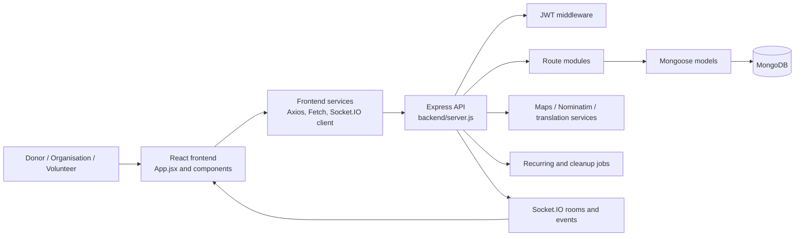
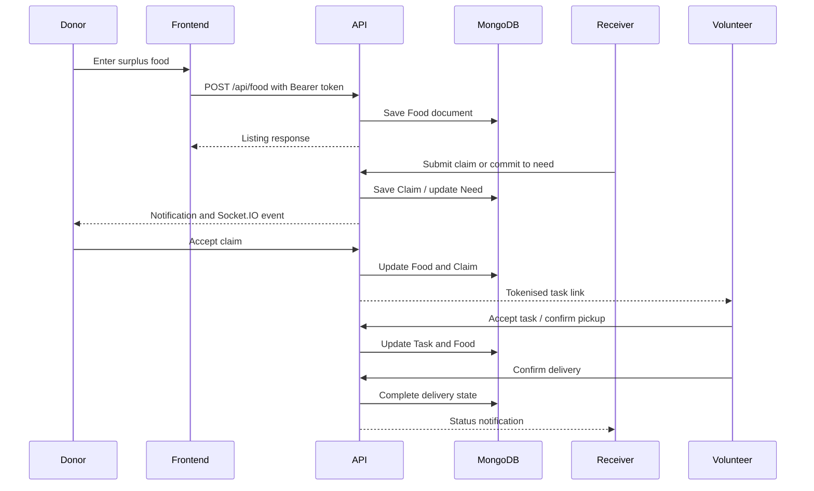

# Community Engagement Project Report

## Project Title

**Donor–Receiver Bridge Platform for Food Redistribution**

**Student:** [TO BE FILLED BY STUDENT: student name]  
**Programme / Department:** [TO BE FILLED BY STUDENT: programme and department]  
**Institution:** [TO BE FILLED BY STUDENT: college or university]  
**Academic Year:** [TO BE FILLED BY STUDENT: academic year]  
**Project Supervisor:** [TO BE FILLED BY STUDENT: supervisor name]  
**Submission Date:** [TO BE FILLED BY STUDENT: submission date]

> **Evidence note.** Technical descriptions in this report are based on the authored files in this workspace, especially `backend/server.js`, the backend route and model files, `frontend/src/App.jsx`, frontend services, and the package manifests. Community names, field activities, participants, dates, measured benefits, and partnerships are not assumed unless they are explicitly represented as application/demo data. Where the project context is incomplete, the report uses the required student-fill-in marker.

# Chapter 1: Introduction

## 1.1 Introduction

Food wastage and food insecurity are social problems that require coordination between people who have surplus food and organisations that can receive and distribute it. This project presents a web-based Donor–Receiver Bridge Platform intended to support that coordination. The application provides a common digital space for donor accounts, receiving organisations, food postings, shortage requirements, claims, volunteers, pickup confirmation, delivery confirmation, notifications, maps, and activity history. In technical terms, it is a full-stack JavaScript system with a React frontend and an Express/Mongoose backend. The backend stores operational records in MongoDB, while Socket.IO is used for selected real-time updates.

The project is not described as evidence of a completed community intervention unless the student supplies that evidence separately. The source code demonstrates a platform design and implementation. It does not, by itself, prove the number of participating people, the amount of food redistributed, or the social impact achieved. Those facts must be added from field records, interviews, surveys, attendance registers, or other approved evidence. The application includes explicitly labelled demo content in `frontend/src/services/mockData.js`, but that content is not treated as verified community data in this report.

The central engineering idea is a traceable workflow. A donor can create a food listing through backend food routes; an organisation can post or manage a need; claims connect receivers to food; volunteers can be assigned; token-protected pages support pickup and delivery confirmation; and notifications communicate changes. The result is a practical platform concept that combines social purpose with software engineering, database design, authentication, geospatial services, and workflow automation.

## 1.2 Objectives of the Community Engagement Project

The broad objective is to design and implement a digital platform that can make food donation coordination more organised, visible, and trackable. The application expresses this objective through separate account types in `backend/models/User.js`: `ORGANISATION` and `DONOR`. It supports a relationship between surplus and need rather than treating a donation as a one-way form submission. The donor can post available food, the receiving organisation can express requirements, and the system can manage the resulting claim and delivery lifecycle.

The project objectives also include improving communication and accountability. The backend contains claim, notification, activity, confirmation, and task models. The `Notification` model represents events such as claim requests, accepted claims, volunteer assignments, pickup confirmation, and need alerts. The confirmation routes use signed tokens so that a volunteer, donor, or organisation can complete a relevant action without requiring every participant to use the same logged-in session. The Socket.IO logic in `backend/server.js` and notification helper functions support targeted updates to user rooms.

Community-specific objectives remain incomplete because the user has not supplied a field plan or community baseline. Add the following before submission: **[TO BE FILLED BY STUDENT: the local community problem statement, the community selected, the number and type of participants, the intended engagement activity, and the measurable service objectives]**. The software objectives can be reported from the repository, but the engagement objectives must be confirmed by the student’s actual project records.

## 1.3 Relevance to Engineering Discipline

The project is relevant to software engineering because it converts a real-world coordination problem into a set of actors, states, data entities, interfaces, and services. The code demonstrates requirements decomposition: users are represented by `User`, food by `Food`, needs by `Need`, claims by `Claim`, delivery assignments by `Task`, and communication records by `Notification`. Each entity has validation rules and relationships. For example, `FoodSchema` uses enumerated status values such as `AVAILABLE`, `ACCEPTED`, `IN_TRANSIT`, `COMPLETED`, and `CANCELLED`; `ClaimSchema` uses its own claim lifecycle; and `TaskSchema` records volunteer status and confirmation tokens.

The system also illustrates security engineering. `backend/middleware/auth.js` reads a Bearer token, verifies it with JSON Web Token, and attaches the decoded user to the request. Passwords are hashed through a `pre('save')` hook in `backend/models/User.js` using `bcryptjs`. Public confirmation routes use separate signed tokens generated by `backend/utils/confirmationTokens.js`. These mechanisms show the need to protect personal information and action permissions in a community platform.

The project includes geospatial engineering through GeoJSON-style coordinates, 2dsphere indexes, Haversine distance calculations, address geocoding, route retrieval, and map rendering. It also demonstrates distributed interaction through REST APIs and Socket.IO events such as `NEW_NOTIFICATION`, `NOTIFICATION_UPDATED`, `VOLUNTEER_LOCATION`, and `NEW_NEED_LISTING`. Therefore, the project combines application development, data modelling, security, human-computer interaction, and service integration.

## 1.4 Scope of the Project

The software scope covers account registration and login, profile management, donor food listings, organisation requirements, claims, targeted acceptance, rejection, volunteer assignment, pickup and delivery confirmation, active pickup tracking, notification management, history, maps, NGO discovery, profile claims, recurring needs, translation requests, and certificate pages. These responsibilities are mounted in `backend/server.js` under `/api/auth`, `/api/activity`, `/api/food`, `/api/notifications`, `/api/claims`, `/api/needs`, `/api/recurring-needs`, `/api/history`, `/api/confirm`, `/api/translate`, `/api/maps`, and `/api/profile-claims`. The frontend routes in `frontend/src/App.jsx` expose authenticated pages and public confirmation pages.

The project scope does not establish a complete production deployment, a verified community partnership, or a measured social impact. The repository contains no formal field-survey report, ethics approval, user consent record, deployment contract, or test suite with automated assertions. The backend package script named `test` intentionally exits with `Error: no test specified`, so testing must be described as available checks and code-level review rather than as a completed automated test programme.

The report also excludes dependency source code under `node_modules`, Git internals, local environment secrets, runtime logs, and generated bundles as primary project evidence. It recognises localStorage demo services, including `frontend/src/services/donationService.js`, as implementation support or fallback logic rather than proof that all production workflows use the database. **[TO BE FILLED BY STUDENT: final deployment environment, operational users, geographic boundary, and features intentionally excluded from the submitted version]**.

## 1.5 Project Methodology

The technical methodology followed in this report is repository-based analysis. First, the project structure and package manifests were inspected to identify the frontend, backend, libraries, scripts, and configuration. Second, application entry points were traced from `frontend/src/main.jsx` to `frontend/src/App.jsx`, and from `backend/server.js` to route modules, models, middleware, jobs, services, and utilities. Third, feature behavior was mapped to data entities and API routes. Finally, the implementation was organised into a report structure and checked against the requested chapter headings.

At the software level, the project uses a layered approach. React components and pages provide the user interface. Service modules such as `donationService.js`, `matchingService.js`, `mapApi.js`, and `ngoDirectoryService.js` isolate data and integration logic. Express route modules expose application operations. Mongoose models define persistence structures. Background processes handle recurring needs and expiry cleanup. Socket.IO provides selected event delivery. The code uses a mixture of database-backed routes and frontend localStorage/demo services, which must be considered when evaluating deployment readiness.

The community-engagement methodology is not fully documented in the workspace. The student should add the actual engagement process, including consultation, needs identification, intervention, feedback, and evaluation. **[TO BE FILLED BY STUDENT: research and engagement dates, meeting method, participant selection, consent process, data collection tools, and evaluation method]**. No unsupported claim about a community visit, workshop, or partnership is made here.

# Chapter 2: Project Description

## 2.1 Project Overview

The project is a digital bridge between food donors and receiving organisations. The donor side can create a food listing with quantity, food type, preparation time, expiry time, pickup address, notes, photos, and status. The organisation side can publish a need with title, category, quantity, unit, urgency, description, needed-by date, and location. The backend data model allows food and needs to be linked through claims and fulfilment fields. This reflects a coordination model in which a surplus item is not considered complete merely because it has been posted; it must move through matching, acceptance, collection, transport, and receipt.

The user interface is routed through `frontend/src/App.jsx`. Public routes include `/pickup/:taskId`, `/confirm-pickup/:taskId`, `/confirm-delivery/:taskId`, and `/certificate/:id`. Authenticated users receive an `AppLayout`, with the root route selecting `DonorDashboard` or `NGODashboard` according to `user.role`. Other authenticated routes include `/activity`, `/map`, `/ngos`, `/find-ngos`, `/ngo/:id`, `/ngo-requests`, `/donate`, `/donor/log-surplus`, `/donor/volunteer`, and tracking redirects. The application also includes a language provider, dark-mode preference, an error boundary, and Socket.IO connection setup.

The backend starts only after connecting to MongoDB. It installs CORS, JSON and URL-encoded body parsing, database-readiness middleware, route mounts, Socket.IO event handlers, the expiry cleanup interval, and the recurring-needs job. This makes the platform a combination of ordinary request/response operations, event-driven updates, scheduled operations, and external mapping/directory integrations.

## 2.2 Project Activities and Interventions

The software activities represented by the project are organised around a donation lifecycle. A donor registers or logs in, enters a surplus listing, and the system stores it through the food API. An organisation can view available food, post a need, or submit a claim. Donor-facing claim routes allow acceptance or decline, while organisation confirmation routes allow the receiving side to confirm its stage. The `Task` model and confirmation routes extend the workflow to a volunteer assignment. The volunteer can receive a tokenised task link, accept or decline the task, and participate in pickup and delivery confirmation.

The intervention also includes communication and visibility. The backend creates or updates notifications through `backend/utils/notificationHelper.js`, which sanitises messages, upserts one notification per user and food record, and emits targeted events. The frontend contains `NotificationsDrawer.jsx`, `ActivePickupsDrawer.jsx`, `MyPostingsDrawer.jsx`, `MyShortagesDrawer.jsx`, and `HistoryDetailDrawer.jsx` for operational views. The map layer provides geocoding and route support, while `matchingService.js` calculates a weighted score using category, item, distance, urgency, and quantity.

The actual community activities are not present in the supplied project context. **[TO BE FILLED BY STUDENT: describe the meetings, awareness activity, food collection activity, training, feedback sessions, or other intervention activities actually completed]**. Do not present the application’s demo records as community outcomes. If a pilot was run, add dates, participants, location, procedure, and evidence separately.

## 2.3 Target Community and Beneficiaries

The application’s intended user roles can be inferred from its data and interface: donors, receiving organisations or NGOs, volunteers, and administrators who review external organisation profile claims. The `User` model supports `DONOR` and `ORGANISATION` account types. `ProfileClaim` records a request to claim an externally discovered organisation and contains an approval status, contact details, source identity, and optional proof document URL. The frontend includes donor pages, NGO pages, volunteer pages, a directory, and administrative claim review components.

The repository also contains location-oriented examples such as Pune localities and a list of available cities in `ngoDirectoryService.js`. These are implementation choices and demo defaults, not evidence that the student engaged a particular locality or organisation. Similarly, `mockData.js` includes explicitly labelled demo donors and donation records; these should not be counted as real beneficiaries or partners.

The verified target community is missing from the supplied context. **[TO BE FILLED BY STUDENT: name and description of the target community, geographic area, primary beneficiaries, donor groups, receiving organisations, volunteer groups, inclusion considerations, and estimated participant numbers]**. Add a clear distinction between direct beneficiaries, indirect beneficiaries, project users, and future users. If vulnerable groups are involved, the final report should also state how privacy, dignity, consent, and safety were addressed.

## 2.4 Project Timeline and Milestones

The source code contains implementation dates in demo records such as `2026-08-23` in `frontend/src/services/mockData.js`, but these are sample donation data and must not be interpreted as the student’s project timeline. The repository does not provide a reliable academic schedule, community consultation schedule, or release history. The timeline below therefore records technical milestones at a descriptive level and marks the community milestones for student completion.

| Milestone | Evidence or activity | Date / period |
|---|---|---|
| Project problem identification | Food donation coordination concept | [TO BE FILLED BY STUDENT: date] |
| Community consultation | Actual consultation or needs assessment | [TO BE FILLED BY STUDENT: date or period] |
| Requirements definition | Donor, organisation, volunteer, map, claim, and notification requirements | [TO BE FILLED BY STUDENT: date or period] |
| Backend foundation | Express server, MongoDB/Mongoose models, authentication, and mounted API routes | [TO BE FILLED BY STUDENT: date or period] |
| Frontend foundation | React/Vite entry point, routing, layouts, dashboards, and services | [TO BE FILLED BY STUDENT: date or period] |
| Workflow implementation | Claims, volunteers, token confirmation, tracking, notifications, and history | [TO BE FILLED BY STUDENT: date or period] |
| Pilot or demonstration | Actual user demonstration or community test | [TO BE FILLED BY STUDENT: date or period] |
| Feedback and revision | Feedback received and changes made | [TO BE FILLED BY STUDENT: date or period] |
| Final evaluation | Technical and community evaluation | [TO BE FILLED BY STUDENT: date or period] |

The student should replace the markers with dates supported by a project diary, Git history, meeting records, or supervisor confirmation. If no community pilot occurred, the milestone should say “not conducted” rather than implying completion.

# Chapter 3: Objectives and Outcomes

## 3.1 Project Objectives

The technical objectives are to provide structured user accounts, connect surplus food with organisational needs, support an auditable claim process, coordinate volunteers, provide map and route information, issue status notifications, and maintain records of activity and delivery. These objectives are reflected in the code. Authentication and profiles are handled by `routes/auth.js` and `models/User.js`; food management is handled by `routes/food.js` and `models/Food.js`; needs are handled by `routes/needs.js` and `models/Need.js`; claims are handled by `routes/claims.js` and `models/Claim.js`; volunteer logistics are represented by `Task.js` and `routes/confirmation.js`; and operational communication is represented by `Notification.js`, `notificationHelper.js`, and Socket.IO.

The project also aims to reduce uncertainty in matching. `matchingService.js` calculates a score with category weight 30%, item weight 25%, location/distance weight 20%, urgency weight 15%, and quantity compatibility weight 10%. `calculateHaversineDistance` provides a distance estimate when coordinates are present. The map services support geocoding and route retrieval, with backend proxying intended to keep external keys server-side in `mapApi.js` and `routes/maps.js`.

The community objectives must be stated by the student. **[TO BE FILLED BY STUDENT: community-specific objectives, baseline problem, desired behavioural change, planned service level, and indicators agreed with participants or supervisor]**. A software feature should not be described as a social outcome without evidence that people used it and benefited from it.

## 3.2 Expected Outcomes

Expected technical outcomes include a working interface for donor and organisation workflows, persistent records in MongoDB, role-aware access, a searchable organisation directory, food and need lifecycle states, token-protected confirmation pages, volunteer assignment, location-based views, and notification updates. The frontend route structure supports separate dashboards and public task links. The backend uses model relationships and populated queries so that claims, food, users, and tasks can be displayed together. The recurring job can create new `Need` records from active `RecurringNeedTemplate` documents when their `nextOccurrence` is due.

The source also supports several reliability-oriented outcomes. Expired food records can be cleaned by `autoDeleteService.js`; confirmation tokens have expiration periods; notification messages are sanitised to remove four-digit codes; and per-user Socket.IO rooms are used for targeted notification delivery. The system has fallback behaviour for geocoding, including Nominatim and known locality coordinates, and the frontend can use OpenStreetMap discovery when a Google Places key is not configured.

Community outcomes are not measurable from the repository alone. **[TO BE FILLED BY STUDENT: expected number of users, number of donation or need records, expected reduction in coordination time, expected beneficiary reach, expected volunteer participation, and evaluation indicators]**. Use “expected” only for planned targets and “achieved” only when supported by dated records.

## 3.3 Impact on the Community

The potential community value of the platform is improved coordination. A donor listing can preserve details such as quantity, food type, preparation time, expiry time, location, and notes. A receiver need can express category, quantity, urgency, and a required date. A claim and task process can create a visible chain from offer to receipt. Notifications and history can reduce the need for participants to rely only on informal messages. The map and distance functions can help users judge whether a pickup is practical, while volunteer location events can provide a live status during transport.

These are plausible mechanisms of impact, not measured impact claims. The repository does not contain surveys, before-and-after comparisons, beneficiary interviews, delivery totals, or independent verification. The mock records in `mockData.js` are labelled demo data and include fictional-looking names and `.demo` contact details; they must be excluded from impact calculations. The application may support a future community intervention, but the report must not claim that food insecurity was reduced or that a certain number of people were served without evidence.

**[TO BE FILLED BY STUDENT: actual community impact, beneficiary testimony, service statistics, comparison with the baseline, unintended effects, and supporting evidence]**. If no pilot has occurred, state that the impact is prospective and describe the proposed evaluation plan instead.

## 3.4 Challenges and Lessons Learned

The code reveals several engineering challenges. The workflow contains many statuses across multiple models, so consistency between food status, claim status, task status, notification stage, and confirmation state is important. The food model is extensive and supports both single-level fields and item arrays, which increases flexibility but also increases validation and maintenance effort. Location data may be missing or represented differently, so the frontend checks for valid latitude and longitude before calculating distances or requesting routes. External services can fail, so `geocoder.js` falls back from Google to Nominatim and then to known locality coordinates.

The application also combines database-backed functionality with a localStorage-based service layer. `donationService.js` stores donations, requests, notifications, and NGOs under localStorage keys and imports seed data from `mockData.js`. This can be useful for interface development, but it creates a clear boundary that must be documented before production use. Testing is another challenge: `backend/package.json` has no implemented test command, while the frontend provides build and lint scripts but no dedicated unit-test script.

Lessons from the repository include the importance of explicit state machines, centralised integration services, careful token handling, and clear separation between demo data and real records. Community lessons cannot be inferred. **[TO BE FILLED BY STUDENT: communication challenges, participant feedback, access barriers, cultural or language considerations, and lessons from actual engagement]**.

# Chapter 4: Methodology and Implementation

## 4.1 Research Design

The technical research design is an applied design-and-development approach. The project identifies a coordination problem, models its participants and transactions, implements a web platform, and evaluates the implementation through code inspection and available build/lint checks. The repository supports this design through a separation of concerns: React components and services on the client, Express route modules on the server, Mongoose models for data, scheduled jobs for recurring operations, and utilities for geocoding, notifications, and confirmation tokens.

The report does not claim that a formal experimental or survey design was completed because none is documented in the supplied context. For a community evaluation, a suitable design would combine process evidence and participant feedback: record the number of people consulted, observe the donation workflow, collect usability feedback, and compare planned indicators with actual results. **[TO BE FILLED BY STUDENT: research questions, participant sampling method, instruments, consent procedure, baseline, post-intervention method, and ethical safeguards]**.

The technical evaluation should distinguish static correctness from operational effectiveness. A successful frontend build shows that the production bundle can be generated; it does not prove that MongoDB, external maps, Socket.IO, token links, and all role-specific workflows operate correctly in deployment. Likewise, a code review can identify route and model behaviour but cannot replace testing with real users.

## 4.2 Requirement Analysis (functional and non-functional)

### Functional requirements

| ID | Requirement | Code evidence |
|---|---|---|
| FR1 | Register and authenticate donor or organisation users | `backend/routes/auth.js`, `backend/models/User.js`, `backend/middleware/auth.js` |
| FR2 | Create, view, update, reject, cancel, and complete food listings | `backend/routes/food.js`, `backend/models/Food.js` |
| FR3 | Post and manage organisational needs | `backend/routes/needs.js`, `backend/models/Need.js` |
| FR4 | Submit, accept, decline, and confirm claims | `backend/routes/claims.js`, `backend/models/Claim.js` |
| FR5 | Assign volunteers and track task state | `backend/routes/food.js`, `backend/routes/confirmation.js`, `backend/models/Task.js` |
| FR6 | Confirm pickup and delivery through tokenised pages | `backend/utils/confirmationTokens.js`, `/api/confirm/*`, frontend confirmation pages |
| FR7 | Send and manage notifications | `backend/models/Notification.js`, `notificationHelper.js`, `/api/notifications/*` |
| FR8 | Display maps, geocode addresses, and request routes | `routes/maps.js`, `mapApi.js`, `mapsService.js`, `MapPage.jsx` |
| FR9 | Discover and claim external organisation profiles | `ngoDirectoryService.js`, `routes/profileClaims.js`, `ProfileClaim.js` |
| FR10 | Generate recurring needs and remove expired food | `jobs/recurringJob.js`, `services/autoDeleteService.js` |

### Non-functional requirements

The code indicates requirements for authentication, role checks, token expiry, targeted notification privacy, input validation, database readiness, responsive interface behaviour, fallback handling, and maintainability through service modules. `server.js` returns HTTP 503 while MongoDB is not ready. `auth.js` verifies JWTs. Socket.IO user rooms aim to limit private events. Map helpers return `null` rather than throwing for many invalid or failed requests. The frontend uses React routing, an error boundary, dark-mode preference, and language context. **[TO BE FILLED BY STUDENT: required response time, availability target, supported browsers/devices, accessibility standard, privacy policy, data retention period, and recovery target]**.

## 4.3 Project Planning

The implementation can be planned as sequential but iterative work packages. The first package is problem and actor modelling: identify donors, receiving organisations, volunteers, and administrators. The second is data design: define User, Food, Need, Claim, Task, Notification, Activity, RecurringNeedTemplate, and ProfileClaim. The third is backend foundation: configure Express, MongoDB connection, middleware, authentication, and route mounts. The fourth is core workflow: food, needs, claims, notifications, and history. The fifth is logistics: volunteers, confirmation tokens, pickup/delivery status, maps, and live location. The sixth is frontend integration: route pages, dashboards, drawers, forms, service modules, and language/theme support.

The repository shows signs of iterative development through standalone update scripts, old component copies, backup files, diff files, and mock-data utilities. These artefacts are useful development evidence but should not be treated as production modules. The main package scripts provide frontend development, build, preview, lint, and security-code checks; the backend provides start, watch-mode development, and security-code checks. There is no completed automated test script.

A project plan should include review gates for security, data privacy, workflow consistency, and user acceptance. **[TO BE FILLED BY STUDENT: assigned responsibilities, planned work periods, supervisor reviews, community review points, risk register, and final acceptance criteria]**. The timeline should distinguish implementation completion from community deployment or engagement completion.

## 4.4 Technologies Used

| Technology / package | Purpose in the project | Evidence |
|---|---|---|
| React 19 | Frontend component and page development | `frontend/package.json`, `src/components`, `src/pages` |
| Vite | Frontend development server and production build | `frontend/package.json`, `frontend/vite.config.js` |
| React Router DOM | Client-side route and access-flow management | `frontend/src/App.jsx` |
| Axios and Fetch | HTTP requests to backend and external/proxy services | Frontend components and service modules |
| Express 5 | Backend HTTP server and route middleware | `backend/server.js`, `backend/package.json` |
| Mongoose 9 | MongoDB schemas, models, queries, and indexes | `backend/models/*.js` |
| MongoDB | Persistent application database configured by `MONGO_URI` | `backend/server.js` |
| JSON Web Token | Authentication and confirmation-token signing | `middleware/auth.js`, `utils/confirmationTokens.js` |
| bcryptjs | Password hashing before user persistence | `backend/models/User.js` |
| Socket.IO | Targeted notifications and live volunteer-location events | `server.js`, frontend `socket.io-client` use |
| node-cron | Fifteen-minute recurring-needs generation job | `backend/jobs/recurringJob.js` |
| Leaflet / React Leaflet | Map rendering and map CSS integration | `frontend/package.json`, `main.jsx`, map components |
| Google Maps / OpenStreetMap services | Geocoding, routing, discovery, and map URLs | `mapApi.js`, `mapsService.js`, `geocoder.js`, `ngoDirectoryService.js` |
| Tailwind CSS | Utility styling and theme configuration | `tailwind.config.js`, `index.css`, package manifest |
| Lucide React | Interface icons | `frontend/package.json` and component imports |
| jsPDF and autotable | PDF/certificate or tabular document generation support | `frontend/package.json` and certificate components |
| QRCode React / QRCode | QR-related confirmation or sharing support | package manifests and backend dependency |
| Snyk and Oxlint | Security/code analysis and frontend linting | package scripts and `.oxlintrc.json` |

## 4.5 Implementation (file-by-file explanation, architecture diagram, data flow)

### File and module explanation

The backend entry point is `backend/server.js`. It loads environment variables, creates the Express and HTTP servers, attaches Socket.IO, applies CORS and body parsing, rejects requests before MongoDB readiness, mounts all API routers, handles room membership, accepts volunteer location updates, exposes `emitToUser`, connects to MongoDB, starts expiry cleanup, starts recurring needs, and listens on the configured port. `backend/middleware/auth.js` verifies Bearer JWTs. `backend/models/User.js` stores account type, credentials, profile data, location, and verification state; its save hook hashes passwords. `Food.js` stores the donation lifecycle, times, location, volunteer assignments, photos, receipt condition, live GPS, and confirmation tokens. `Need.js` stores organisational requirements. `Claim.js` links an NGO to food. `Task.js` records volunteer work. `Notification.js` stores per-user events and dismissal state. `Activity.js`, `RecurringNeedTemplate.js`, and `ProfileClaim.js` support history, repeated needs, and directory verification.

The backend route modules have distinct responsibilities. `routes/auth.js` registers, logs in, retrieves the current user, updates profiles, and lists organisations. `routes/food.js` manages listings, claims, statuses, volunteers, certificates, and receipt condition. `routes/needs.js` manages requirements and commitments. `routes/claims.js` manages donor requests and organisation confirmation. `routes/confirmation.js` implements public token-protected volunteer, pickup, and delivery actions. `routes/notifications.js`, `activity.js`, and `history.js` provide user records. `routes/maps.js` proxies geocoding and route operations. `routes/profileClaims.js` manages external profile claims. `routes/recurringNeeds.js` manages templates. `routes/translate.js` forwards translation requests.

The frontend entry point is `frontend/src/main.jsx`, which mounts `App` under React `StrictMode` and loads global and Leaflet styles. `frontend/src/App.jsx` defines public and authenticated routes, fetches `/api/auth/me`, stores the token, manages theme preference, creates the Socket.IO client, and selects donor or organisation dashboards. `components` contain forms, modals, drawers, pages, illustrations, and shared UI. `pages/donor` and `pages/ngo` provide role-specific dashboards. `services/donationService.js` offers localStorage-backed donation and request operations; `matchingService.js` implements weighted matching; `mapApi.js` calls backend map proxies and decodes polylines; `mapsService.js` loads Google Maps, geolocates, calculates distances, and supplies fallback route information; `ngoDirectoryService.js` combines registered database organisations with external discovery; and `context/LanguageContext.jsx` manages language translation requests.



### Data flow

For a normal donation, the user enters data in a frontend form, the frontend sends an authenticated request to a `/api/food` route, the route validates permissions and writes a `Food` document, and the response updates the dashboard. For a claim, an organisation posts to `/api/food/:id/claim` or uses a need-related operation; the backend creates or updates claim and notification records. A donor decision updates the claim and food lifecycle and may call `upsertDonationNotification`. A volunteer assignment creates task-related information and confirmation tokens. Public confirmation pages call `/api/confirm/*` with a token, the backend validates token type and single-use state, updates the relevant task or food state, and emits updates. For maps, the frontend sends coordinates or an address to `/api/maps/geocode` or `/api/maps/route`, while the backend keeps provider credentials server-side where configured.



## 4.6 Monitoring and Testing

Monitoring is represented by application records and runtime events rather than a formal monitoring platform. `Activity` records user actions. `Notification` records lifecycle communication. Food and task status fields provide operational state. `backend/server.js` logs database connection, server startup, socket connections, room changes, and volunteer-location errors. `autoDeleteService.js` logs expired listing cleanup. `recurringJob.js` logs generation activity and errors. These logs can help developers diagnose workflow events, but they are not a complete audit or monitoring solution.

The available project checks are limited. The frontend manifest defines `npm run build`, `npm run lint`, and `npm run code-check`. The root manifest defines code checks for the project, backend, and frontend. The backend manifest defines `start`, `dev`, `test`, and `code-check`; its `test` command is a deliberate placeholder that exits with an error because no automated tests are configured. The repository includes `backend/scratch_test_pickups.js`, but that file is a scratch utility rather than a standard test suite. The report should therefore state exactly which checks were run and their results.

Recommended testing covers authentication, role permissions, food status transitions, claim acceptance and decline, token expiry and single-use behaviour, volunteer assignment, notification privacy, map failure fallback, recurring need duplication prevention, expired-food cleanup, responsive frontend routes, and accessibility. **[TO BE FILLED BY STUDENT: actual test cases, test dates, devices/browsers, user acceptance participants, defects, fixes, and final pass/fail results]**.

## 4.7 Collaborations and Partnerships

The code supports a partnership model involving donors, organisations, volunteers, and potentially external directory providers. The `ngoDirectoryService.js` comments describe registered organisations as Tier 1 and discovered organisations as Tier 2. External discovery can use OpenStreetMap or Google Places depending on configuration. `ProfileClaim` provides a path for an organisation to request verification and administrative onboarding. These are system mechanisms, not proof of actual partnerships.

No named community organisation, food business, volunteer group, municipal body, or academic partner has been supplied as verified project context. Names in demo data and code comments should not be presented as real project partners. **[TO BE FILLED BY STUDENT: partner names, contact persons, role of each partner, dates of collaboration, permissions obtained, contributions, and evidence such as letters or meeting minutes]**. If external providers were used, record their attribution and applicable usage conditions separately. The final report should also explain how partner data was verified and how personal contact information was protected.

# Chapter 5: Impact and Sustainability

## 5.1 Community Impact

The platform’s intended impact pathway is to reduce coordination friction between surplus and need. Structured donation fields can make offers easier to understand. Need records can make demand more visible. Claims and status states can make responsibility clearer. Volunteer task links and confirmation tokens can support a traceable handover. Notifications can help donors and organisations react to status changes. Maps and distance calculations can support practical routing. Recurring needs can represent predictable demand, while expiry cleanup can reduce the display of outdated food offers.

The potential impact must be separated from verified impact. The repository provides no reliable evidence of real users, completed deliveries, food quantities, beneficiary counts, avoided waste, or improved access. Demo entries in `mockData.js` and localStorage records are not community monitoring data. **[TO BE FILLED BY STUDENT: actual impact narrative, quantitative results, qualitative feedback, equity effects, and evidence collection method]**. If a pilot was not completed, describe this section as a projected impact and include a concrete future measurement plan rather than claiming success.

## 5.2 Sustainability Plan

Technical sustainability can be supported by maintaining the separation between frontend, backend, models, services, and utilities. Environment variables are used for API URLs, MongoDB connection, JWT secrets, frontend URLs, and map keys. The backend packages define regular start and development commands, while the frontend defines development, build, preview, lint, and code-check commands. The use of Mongoose schemas and indexes provides a foundation for maintaining data integrity and geospatial queries. Scheduled cleanup and recurring needs reduce manual maintenance for particular workflows.

Operational sustainability requires more than code. A responsible plan should identify who will administer users, review profile claims, monitor failed deliveries, protect credentials, respond to data requests, and update external integrations. The platform should use production secrets rather than fallback development secrets, restrict CORS origins, review data retention, and create backups. The localStorage-based service layer should be clearly classified as fallback/demo functionality or replaced with consistent backend persistence before a large deployment.

**[TO BE FILLED BY STUDENT: person or organisation responsible for maintenance, funding model, hosting plan, training plan, data governance, support process, and sustainability review schedule]**. Any claim that a partner has agreed to maintain the system requires written evidence.

## 5.3 Scalability

The architecture has several features that can support growth. Express route modules can be extended independently, Mongoose models can add indexes and validation, and React pages can be expanded under the existing routing structure. Socket.IO rooms allow notifications to be addressed to users rather than broadcast indiscriminately. The organisation directory uses an in-memory five-minute cache for discovery queries to reduce repeated external requests. The recurring needs job avoids creating a duplicate active need for the same template. Geospatial indexes on User, Food, Need, and RecurringNeedTemplate provide a basis for location queries.

Scalability risks also exist. The server currently connects and listens from one process, the recurring job is started inside the application process, and the Socket.IO configuration uses an open origin. The localStorage service is browser-local and cannot provide shared multi-user consistency. External map and directory services have rate limits and attribution requirements. Notification queries and food workflow queries may require additional indexes and pagination as records grow. The application should be load-tested before production expansion.

**[TO BE FILLED BY STUDENT: expected user growth, geographic expansion, hosting architecture, budget, service-level target, and scale test results]**. Scaling to additional cities should also include local partner verification and language/accessibility review rather than only technical replication.

# Chapter 6: Reflection and Recommendations

## 6.1 Reflection

From a software engineering perspective, the project demonstrates how a social coordination problem can be represented as a set of connected workflows. The most important design decision is the movement from simple posting to lifecycle management. Food, needs, claims, tasks, notifications, and confirmations each describe a stage of responsibility. The application also shows the value of separating reusable logic into services: weighted matching is isolated in `matchingService.js`, route and geocoder operations are separated from page components, and notification upserting is centralised in `notificationHelper.js`.

The project also highlights the difference between a prototype and a validated community service. The repository contains useful implementation depth, including status transitions, token links, live location, maps, recurring needs, and profile claims. However, the absence of formal automated tests, documented field engagement, measured outcomes, and a complete deployment record limits the claims that can be made. This is not a weakness to hide; it is an important reflection point for responsible engineering.

**[TO BE FILLED BY STUDENT: personal reflection on teamwork, communication, ethical decisions, user interaction, time management, and how feedback changed the project]**. The student should connect the reflection to specific events and evidence rather than writing only general statements.

## 6.2 Challenges Faced

Technical challenges include managing several related state machines, handling missing or inconsistent coordinates, integrating external services, protecting private notifications, and keeping the user interface aligned with backend status changes. The code contains fallback paths for geocoding and maps, but those paths must be tested under network failure. The extensive `Food` model includes both legacy-style fields and newer logistics fields, so future maintenance should confirm which fields are authoritative. The frontend includes localStorage demo logic alongside API-backed screens, which can make environment behaviour differ between development and deployment.

Security and operational challenges include fallback JWT secrets in code, open Socket.IO CORS configuration, public confirmation endpoints that depend on token security, and the need to prevent sensitive information from appearing in notifications or logs. `sanitizeMessage` removes four-digit codes from notification text, which shows awareness of this risk, but a complete security review is still required. The project’s testing infrastructure is incomplete because the backend test script is not implemented.

Community challenges are unknown. **[TO BE FILLED BY STUDENT: actual barriers such as access to smartphones, internet reliability, language, trust, food safety concerns, scheduling, transport, or partner availability]**. These should be supported by notes or participant feedback.

## 6.3 Lessons Learned

The project teaches that domain terminology must be represented consistently. “Food available,” “claim accepted,” “volunteer assigned,” “picked up,” “in transit,” “delivered,” and “completed” are not merely labels; they affect notifications, permissions, cleanup, certificates, and historical records. A central status specification and transition table would reduce ambiguity. It also teaches that integration boundaries must be explicit. The frontend can call backend APIs, external map providers, Nominatim, or local fallback functions, and each source has different reliability and privacy properties.

Another lesson is that demo data needs strict labelling. `mockData.js` clearly includes demo donations, demo notifications, and demo donors. Keeping this data separate from real records is essential when presenting impact or testing privacy. The platform also demonstrates that accessibility and trust are part of engineering. Tokenised public pages may simplify participation for volunteers, but links must be protected and revocable. Map features are helpful, but users need meaningful alternatives when location permission or external services are unavailable.

**[TO BE FILLED BY STUDENT: lessons learned from community members, supervisor, collaborators, testing participants, and project management]**. Include at least one lesson that changed a design or implementation decision.

## 6.4 Recommendations

The first recommendation is to establish a complete automated testing foundation. Add backend route tests with a test database, model validation tests, token tests, and frontend unit/component tests for forms, role routing, status display, and service failures. Replace the placeholder backend test script. The second recommendation is to define a single workflow state model shared by food, claim, task, notification, and UI code. The third is to remove production fallback secrets, restrict CORS, validate all user inputs consistently, and perform a security review of public confirmation routes and external service calls.

The fourth recommendation is to choose one authoritative persistence path for each production feature. If the database is authoritative, localStorage should be limited to clearly identified offline or demo features. Add pagination, indexes, rate limiting, structured logs, backups, monitoring, and a queue or separate worker for scheduled jobs at larger scale. Add accessibility testing, keyboard navigation, readable status labels, language review, and clear consent messages for location sharing.

For community implementation, the project should conduct a small, documented pilot before claiming impact. **[TO BE FILLED BY STUDENT: prioritised recommendations from participants and partners]**. Collect only necessary personal data, obtain consent, publish a contact and escalation process, and measure both successful and unsuccessful donation attempts. Recommendations should be assigned an owner, deadline, cost, and verification method.

# Chapter 7: Conclusion

This project implements a substantial full-stack foundation for coordinating food donors, receiving organisations, volunteers, and related delivery activities. The React frontend uses route-based dashboards, service modules, reusable components, language context, maps, and real-time Socket.IO communication. The Express backend provides authentication, food and need management, claims, notifications, history, maps, confirmation flows, recurring needs, profile claims, and scheduled cleanup. MongoDB/Mongoose models represent the principal entities, while JWT and bcryptjs provide authentication-related mechanisms.

The platform’s strongest contribution is its attempt to make the complete donation lifecycle visible. It does not stop at publishing an offer: it models needs, claims, decisions, volunteer tasks, pickup, delivery, notifications, live location, and history. The weighted matching service, geospatial functions, recurring need generation, expiry cleanup, and tokenised confirmation links demonstrate practical engineering choices.

At the same time, responsible reporting requires a clear boundary. The repository establishes software behaviour, not community impact. It does not provide verified participant information, actual partner agreements, field activity records, measured outcomes, or a finished automated test suite. These details must be supplied by the student or explicitly reported as not completed. With a documented community pilot, stronger security and testing, consistent persistence, accessibility review, and a sustainability plan, the platform could provide a useful basis for a community food-redistribution service.

# Chapter 8: Appendices

## Appendix A: Supporting Information

### A.1 Folder tree

```text
C:\Users\Lenovo ThinkPad\Documents\Shreyas\NGO-Food-Service\
├── backend\
│   ├── server.js
│   ├── middleware\auth.js
│   ├── models\
│   │   ├── Activity.js
│   │   ├── Claim.js
│   │   ├── Food.js
│   │   ├── Need.js
│   │   ├── Notification.js
│   │   ├── ProfileClaim.js
│   │   ├── RecurringNeedTemplate.js
│   │   ├── Task.js
│   │   └── User.js
│   ├── routes\
│   │   ├── activity.js, auth.js, claims.js, confirmation.js
│   │   ├── food.js, history.js, maps.js, needs.js
│   │   ├── notifications.js, profileClaims.js
│   │   ├── recurringNeeds.js, translate.js
│   ├── jobs\recurringJob.js
│   ├── services\autoDeleteService.js
│   └── utils\confirmationTokens.js, geocoder.js, notificationHelper.js
├── frontend\
│   ├── src\App.jsx, main.jsx, index.css
│   ├── src\components\
│   ├── src\context\LanguageContext.jsx
│   ├── src\i18n\translations.js
│   ├── src\pages\donor\ and src\pages\ngo\
│   ├── src\services\
│   ├── src\utils\
│   ├── package.json
│   ├── vite.config.js
│   └── tailwind.config.js
├── package.json
└── COMMUNITY_PROJECT_REPORT.md
```

Generated `dist` files, dependency folders, runtime logs, environment files, and local database dumps should not be treated as source modules. Environment files may contain secrets and must not be copied into a submitted report.

### A.2 API and route list

| Base path | Implemented operations |
|---|---|
| `/api/auth` | `POST /register`, `POST /login`, `GET /me`, `PUT /profile`, `GET /organizations` |
| `/api/activity` | `GET /` |
| `/api/food` | `POST /`, `GET /my-listings`, `GET /incoming`, `GET /`, `GET /active-pickups`, `GET /:id/certificate`, `GET /:id`, `POST /:id/claim`, `PATCH /:id/accept-targeted`, `PATCH /:id/reject`, `PATCH /:id`, `PATCH /:id/owner-delete`, `DELETE /:id`, `PATCH /verify-pickup/:id`, `PATCH /:id/cancel`, `PATCH /:id/collected`, `PATCH /:id/status`, `PATCH /:id/assign-volunteer`, `PATCH /:id/receipt-condition` |
| `/api/claims` | `GET /donor/my-requests`, `GET /:id`, `PATCH /:id/accept`, `PATCH /:id/decline`, `PATCH /:id/ngo-confirm` |
| `/api/confirm` | `GET /task/:taskId`, `GET /pickup/:taskId`, `POST /pickup/:taskId`, `GET /delivery/:taskId`, `POST /delivery/:taskId`, `POST /volunteer-accept/:taskId`, `POST /volunteer-decline/:taskId` |
| `/api/needs` | `POST /`, `GET /`, `GET /my-needs`, `POST /:id/commit`, `POST /:id/unclaim`, `PATCH /:id`, `PATCH /:id/owner-delete`, `DELETE /:id` |
| `/api/notifications` | `GET /:userId`, `PATCH /:id/read`, `PATCH /mark-all-read`, `DELETE /clear-all`, `DELETE /:id` |
| `/api/history` | `GET /` |
| `/api/maps` | `GET /geocode`, `GET /route` |
| `/api/recurring-needs` | `POST /`, `GET /my-templates`, `PATCH /:id`, `DELETE /:id` |
| `/api/profile-claims` | `POST /`, `GET /`, `PATCH /:id` |
| `/api/translate` | `POST /` |

### A.3 Database schema summary

| Model | Main purpose | Important relationships or fields |
|---|---|---|
| `User` | Donor and organisation accounts | `accountType`, credentials, organisation/personal fields, GeoJSON location, verification |
| `Food` | Surplus food listing and lifecycle | `donorId`, quantity, food type, times, status, claimant, volunteer, location, tokens |
| `Need` | Organisation shortage or requirement | `ngoId`, title, category, quantity, urgency, status, fulfilled food, recurring template |
| `Claim` | Organisation request for food | `ngoId`, `foodId`, status, message, pickup time, decline reason |
| `Task` | Volunteer logistics | `claimId`, `foodId`, donor, NGO, volunteer, status, tokens, location |
| `Notification` | Per-user communication | user, type, message, related food/claim, stage, read, dismissed users |
| `Activity` | User activity history | user, action, timestamp |
| `RecurringNeedTemplate` | Repeated requirements | NGO, item details, frequency, status, next occurrence |
| `ProfileClaim` | External organisation verification | source identity, organisation details, submitter, proof, review status |

### A.4 Key code snippets

The following short excerpts identify important mechanisms without reproducing full source files:

```js
// backend/server.js — API mounting
app.use('/api/auth', authRoutes);
app.use('/api/food', foodRoutes);
app.use('/api/claims', claimRoutes);
app.use('/api/needs', needRoutes);
app.use('/api/confirm', confirmationRoutes);
```

```js
// backend/middleware/auth.js — request authentication
const decoded = jwt.verify(token.replace('Bearer ', ''), JWT_SECRET);
req.user = decoded.user;
next();
```

```js
// frontend/src/services/matchingService.js — weighted score result
const totalScore = categoryScore + itemScore + locationScore + urgencyScore + quantityScore;
return Math.min(99, Math.max(45, totalScore));
```

These excerpts are explanatory only. The authoritative implementation is in the named files in the repository.

### A.5 Setup steps

1. Install Node.js and ensure the required version is compatible with the package manifests.
2. From `C:\Users\Lenovo ThinkPad\Documents\Shreyas\NGO-Food-Service`, install root dependencies if required by the root scripts.
3. From `C:\Users\Lenovo ThinkPad\Documents\Shreyas\NGO-Food-Service\backend`, install backend dependencies and create a local environment configuration containing `MONGO_URI`, `JWT_SECRET`, `PORT`, `FRONTEND_URL`, and optional map-provider settings. Do not commit secrets.
4. From `C:\Users\Lenovo ThinkPad\Documents\Shreyas\NGO-Food-Service\frontend`, install frontend dependencies and configure `VITE_API_URL`. Add map keys only according to provider terms and the application configuration.
5. Start MongoDB and confirm that the configured database is reachable.
6. Run the backend with `npm start` or `npm run dev` from the backend directory.
7. Run the frontend with `npm run dev` from the frontend directory.
8. Run `npm run build` and `npm run lint` from the frontend directory for non-destructive validation.
9. Run the available Snyk code-check commands only when credentials/network access and project policy permit them.

The backend test command is not an implemented test suite. **[TO BE FILLED BY STUDENT: exact Node.js version, MongoDB deployment details, environment setup verified by the student, and screenshots or logs of successful startup]**.

## Appendix B: Future Enhancements

Future enhancements should first strengthen reliability and governance. Add automated backend and frontend tests, API schema documentation, central status-transition rules, request validation on every route, rate limiting, structured audit logs, monitoring dashboards, backup and restore procedures, and production secret management. Replace development fallback secrets and restrict CORS. Add pagination and database indexes for high-volume food, need, notification, and history queries. Move scheduled jobs into a worker design when multiple server instances are deployed, and use a shared Socket.IO adapter if horizontal scaling is required.

The user experience can be improved with stronger accessibility, multilingual review by community speakers, low-bandwidth behaviour, offline-safe form recovery, clearer error messages, and notification preferences. Location sharing should have explicit consent, visible status, minimum necessary precision, and a stop-sharing control. External NGO discovery should show provider attribution, verification status, freshness, and a clear claim process. Food safety fields could be expanded with allergen information, storage temperature, packaging condition, and acceptance rules, subject to local guidance.

Community enhancements should be evidence-led. **[TO BE FILLED BY STUDENT: future features requested by participants, partner priorities, estimated cost, implementation owner, and priority order]**. Possible areas include volunteer training, partner dashboards, multilingual onboarding, reporting for community coordinators, food-safety checklists, transport pooling, and outcome dashboards. None should be presented as agreed commitments unless a partner or supervisor has confirmed them.

# References

The following are real, potentially relevant sources. **Verify before use** and adapt the citation style required by the college. They are suggestions, not claims that the project used these sources.

1. MongoDB Documentation, “MongoDB Manual.” **Verify before use.** Relevant for MongoDB data storage, indexes, and geospatial concepts.
2. Mongoose Documentation, “Mongoose ODM.” **Verify before use.** Relevant for schemas, models, middleware, and indexes.
3. Express.js Documentation, “Express - Node.js web application framework.” **Verify before use.** Relevant for routing and middleware.
4. React Documentation, “React.” **Verify before use.** Relevant for component-based user-interface development.
5. Vite Documentation, “Vite.” **Verify before use.** Relevant for frontend development and builds.
6. Socket.IO Documentation, “Socket.IO.” **Verify before use.** Relevant for bidirectional real-time communication and rooms.
7. OpenStreetMap Foundation, “OpenStreetMap Copyright and Licence.” **Verify before use.** Relevant if OpenStreetMap or Nominatim data/services are used.
8. Google Maps Platform Documentation, “Maps Platform Documentation.” **Verify before use.** Relevant if Google Maps, Geocoding, Places, or Routes services are enabled.
9. OWASP Foundation, “OWASP Application Security Verification Standard.” **Verify before use.** Relevant for authentication, session/token handling, access control, and secure development review.
10. World Health Organization, “Food safety.” **Verify before use.** Relevant for food handling and safety background; confirm that any guidance cited is applicable to the project’s jurisdiction.
11. United Nations Environment Programme, “Food Waste Index Report.” **Verify before use.** Relevant for wider food-waste context; confirm the edition and statistics before citing.

**Final verification reminder:** add the student’s actual community evidence, dates, partners, outcomes, and personal reflection before submission. Do not replace the fill-in markers with invented facts.